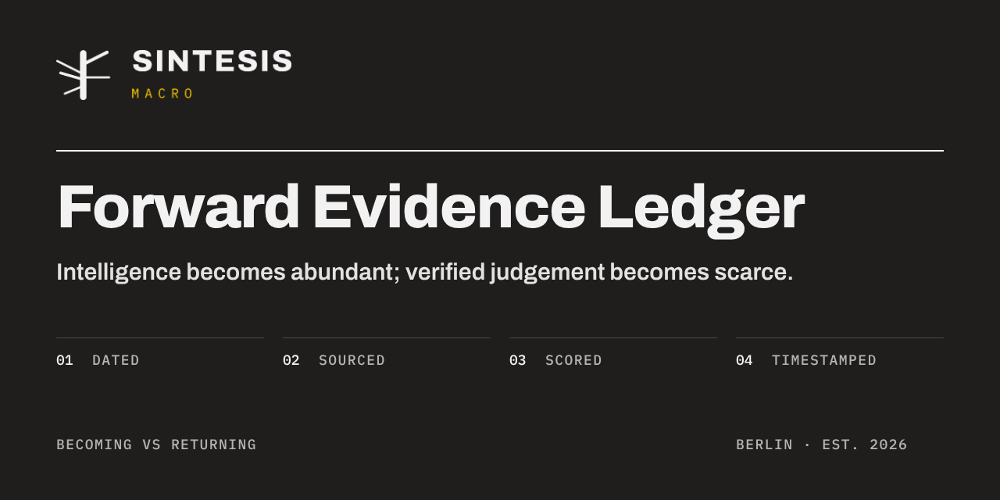

# The SINTESIS Observatory

**[sintesismacro.github.io/observatory](https://sintesismacro.github.io/observatory/)**

The public face of the [Forward Evidence Ledger](https://github.com/sintesismacro/ledger), in
one page:

| Section | What it does |
| --- | --- |
| **The Ledger** | The live scorecard: open and resolved forecasts, Brier score, calibration. |
| **The Atlas** | The ten physical layers of AI in three phases, each with its Becoming and Returning scores, public indicators, practice questions and open-source projects. |
| **Calibration Trainer** | Fourteen questions that have already resolved, each checked against its primary source. Give a probability, see what happened, get a Brier score. Nothing is stored. |
| **The Collection** | The [Physical AI Collection](https://github.com/sintesismacro/physical-ai-collection), filterable by reading. |
| **The Canon** | The thinkers behind the Ledger's rules: Spinoza and Mainländer; Brier, Tetlock and Kahneman; Markowitz, Grinold and Kahn, and Paleologo. |
| **The Guild** | Seats earned by calibration. The Arena opens with the Ledger's first questions. |
| **The Letter** | Quarterly letters merged as pull requests, starting with Letter 0. |

## How it is built

`tools/build.py` reads the Ledger's Atlas layers and scorecard, the Collection and the local
data in `data/`, embeds them in the page and writes `dist/`. The workflow in
`.github/workflows/pages.yml` rebuilds and deploys every day, so the page follows the Ledger
without anyone touching it. Visitors' browsers load nothing from third parties: fonts, images and
data are served from the site itself, and there are no cookies, analytics or tracking.

```sh
pip install pyyaml
python tools/build.py          # fetch the public sources and build dist/
python -m http.server -d dist  # preview on http://localhost:8000
```

## Licence and notice

Code © 2026 SINTESIS UG (haftungsbeschränkt), all rights reserved; data in `data/` under
CC BY 4.0; typefaces under the SIL Open Font License 1.1. See [`LICENSE`](LICENSE). Nothing here
is investment advice. [Imprint](https://sintesismacro.github.io/observatory/imprint/) ·
[Privacy](https://sintesismacro.github.io/observatory/privacy/)

<sub>Prepared 24 October 2026 · Revised 24 October 2026</sub>
